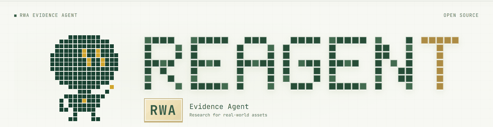
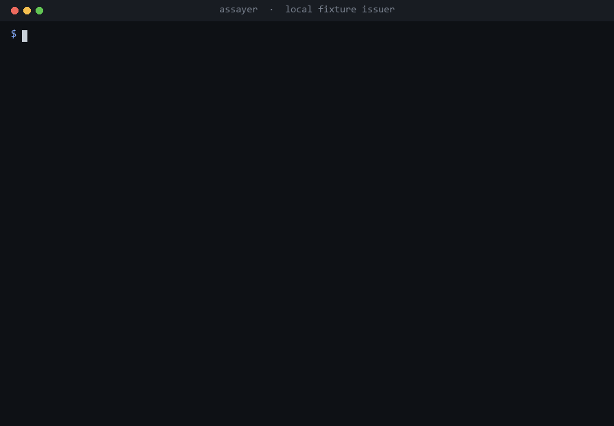

<div align="center">



# REAGENT

**RWA Evidence Agent.** Reads a token and writes one sheet on which every line names the function, the block or the page it came from.


[**MCP for agents**](#for-agents-mcp) · [Quick start](#quick-start) · [The crew](#the-crew) · [Coins](#coins) · [Documents](#assets-with-documents) · [The gate](#the-gate) · [Cost](#cost) · [Docs](#docs)

</div>

---

A token's page says one thing and its contract says another. REAGENT is evidence-backed surveillance of tokens and tokenised real-world assets: it reads the contract, and the issuer's own documents where there are any, and prints what they record. Who can still mint, freeze or tax a transfer, what the prospectus says about your rights, and what drifted since the last look.

It is built the way a Grok Bot team is built: **eight bots, one job each, a lead that fuses their work, and one shared set of evidence.** The hosted desk is at [reagents.tech](https://www.reagents.tech).

> A *reagent* is what an assay office puts a sample through to find out what the metal is actually made of.

---

## For agents: MCP

`assayer mcp` serves REAGENT over the [Model Context Protocol](https://modelcontextprotocol.io). Claude, Cursor, or a trading bot of your own can read a token's contract before it trades, and get back the contract's own answer with the call it came from.

```bash
git clone https://github.com/monokernn/REAGENT.git && cd REAGENT
pip install -e .
claude mcp add reagent -- assayer mcp
```

Then ask your agent in plain language:

> *Can anyone still mint or freeze `DEW9dSN6QpWyNthphCpMmAbZP1Q4cEKR9xQXAri98WDP`? Use reagent.*

<details>
<summary><b>Other clients</b> (Claude Desktop, Cursor)</summary>

Add the server to the client's MCP config:

```json
{
  "mcpServers": {
    "reagent": {
      "command": "assayer",
      "args": ["mcp"],
      "env": { "ASSAYER_HOME": "/path/to/REAGENT" }
    }
  }
}
```

If the app cannot see your `PATH`, give the full path to the executable (on Windows `…\Python310\Scripts\assayer.exe`). `ASSAYER_HOME` points at the project that holds your registered assets, and is needed only by `list_assets` and `show_dossier`.

</details>

| tool | what the agent gets |
|---|---|
| `read_token` | the token read from the chain right now: all twelve readings, the agent that owns each, and the call it came from. Solana, or an EVM chain with an `[rpc]` entry |
| `holder_clusters` | the 100 largest wallets of a Solana token, grouped by the address that first funded each, with the share of supply every cluster holds. Exchanges and busy hubs listed apart. Funding addresses reported by Jupiter |
| `list_assets` | the assets registered in the project, and how many sheets each has |
| `show_dossier` | the latest sheet for one of them, as `assayer show` prints it |

All four are read-only and free. What the agent receives for a live token (abridged):

```
REAGENT  ·  solana:DEW9dSN6QpWyNthphCpMmAbZP1Q4cEKR9xQXAri98WDP  ·  slot 459269815
  calls itself Super Inu (SI)

POWERS LIVE: 2  (ownership, transfer_tax)
  ⚠ Clasp · transfer_tax: a transfer pays 100 basis points (1%); the rate can be
  changed by 5KXDF6QnqhBj72hDtJNkkpFaQVUfbFXNybMsp3DiK6tD
      ↳ transferFeeConfig @ DEW9…8WDP
  ○ Clasp · mint_authority: mint authority is set to none: the supply is fixed
      ↳ getAccountInfo(mint).mintAuthority @ DEW9…8WDP
  ○ Clasp · freeze: freeze authority is set to none: no holder's account can be frozen
      ↳ getAccountInfo(mint).freezeAuthority @ DEW9…8WDP
  · Sift · owner_holdings: 5KXD…K6tD holds 0.0209% of supply
  ? Gauge · liquidity: not checked, no_pool_declared
```

The same reading comes back as structured JSON, so an agent can branch on `powers_live` instead of parsing text.

---

## Quick start

```bash
pip install -e .
assayer doctor
assayer add solana:DEW9dSN6QpWyNthphCpMmAbZP1Q4cEKR9xQXAri98WDP --coin --label "$SI"
assayer snap si
assayer show si
```

A coin on Solana needs no configuration and spends nothing: public endpoints are used unless `[rpc] solana` in `config.toml` names your own. An EVM chain needs one line, an RPC endpoint for it.

---

## The crew

Every reading belongs to exactly one agent, and a test holds that. Each agent is handed only the evidence that bears on its question. A snapshot is collected once and given to all of them at the same moment, so two readings never rest on two different observations of the same contract.

| agent | asks | owns |
|---|---|---|
| **Slate** | Is this a deployed token on this chain, and what does it call itself? | name, symbol, decimals, supply |
| **Clasp** | What does the code still permit somebody to do to your balance? | `ownership` `mint_authority` `burn_authority` `pause` `freeze` `upgradeable` `trading_switch` `transfer_tax` `transfer_limits` |
| **Gauge** | How deep is the pool you would leave through, and can its LP still move? | `liquidity` |
| **Tare** | Where does the supply sit, and how much of it can nobody move? | `burned_supply` `supply_vs_reserves` |
| **Sift** | How much of the supply sits with whoever holds the keys? | `owner_holdings` |
| **Pulse** | What price source does the contract read, and how old is the reserve report? | `oracle` `attestation_freshness` |
| **Docket** | What do the issuer's own documents say? | `instrument_type` `issuer` `holder_rights` `insolvency` `custodian` `corporate_actions` `redemption` `restrictions` |
| **Crucible** | Puts the others together. | the whole picture |

Most of the crew reads bytecode, storage and the stored bytes of a document. Two jobs write: Docket answers the document questionnaire, and five agents can add sentences to a coin sheet. Both run on REAGENT's own model and reach the sheet only after the gate has checked them.

---

## Coins

A memecoin has no prospectus, so seven agents read it straight off the chain. On Solana a token is a mint account on SPL Token or Token-2022, and what makes one token different from another is written into that account: who may print more, who may freeze a holder, and the extensions that take a fee on every transfer, pause the token or run a program on each transfer.

### The twelve readings

| slot | on Solana | on an EVM chain |
|---|---|---|
| `ownership` | every live authority over the mint | does the contract still answer to a live owner |
| `mint_authority` | can supply still be increased, and by whom | the same, from the mint functions |
| `burn_authority` | a permanent delegate that can move or burn any balance | can a balance the owner does not hold be reduced |
| `pause` | the pausable extension and its authority | can transfers be halted |
| `freeze` | the freeze authority over every token account | can one address be blocked |
| `upgradeable` | a transfer hook and who can repoint it | can the logic be replaced, and after what delay |
| `trading_switch` | accounts that start frozen, or a non-transferable token | can transfers be turned on or off |
| `transfer_tax` | the transfer fee: basis points, cap, who changes it | does a transfer pay a fee, and can it move |
| `transfer_limits` | per-transfer and per-wallet caps | the same, as a share of supply |
| `owner_holdings` | share of supply held by the live authority | share of supply in the owner's balance |
| `burned_supply` | share at the incinerator | share at an address with no known key |
| `liquidity` | what the declared pool owns | what the pool holds, and how much of its LP is parked |

Add `--pool <address>` and the `liquidity` slot reads that pool. A pool the asset file does not name is reported under `NOT CHECKED`.

### The sheet

Abridged:

```
ASSAY  ·  COIN  ·  $SI  ·  solana:DEW9dSN6QpWyNthphCpMmAbZP1Q4cEKR9xQXAri98WDP  ·  2026-10-07

! Powers over somebody else's balance are live in this contract: ownership, transfer_tax.

WHAT THIS IS
  the mint calls itself Super Inu (SI)                                                   [chain]
  total supply 996393517508835, 6 decimals                                               [chain]

WHAT THE CONTRACT STILL ALLOWS
  ⚠ ownership: the mint still answers to live authorities — fee:        [chain, block 454318633]
  5KXDF6QnqhBj72hDtJNkkpFaQVUfbFXNybMsp3DiK6tD; metadata: WLHv2UAZm6z4KyaaELi5pjdbJh6RESMva1Rnn8pJVVh
  ○ mint_authority: mint authority is set to none: the supply is fixed  [chain, block 454318633]
  ⚠ transfer_tax: a transfer pays 100 basis points (1%); the rate can   [chain, block 454318633]
  be changed by 5KXDF6QnqhBj72hDtJNkkpFaQVUfbFXNybMsp3DiK6tD
  · owner_holdings: 5KXDF6QnqhBj72hDtJNkkpFaQVUfbFXNybMsp3DiK6tD holds  [chain, block 454318633]
  0.0076% of supply

NOT CHECKED
  ? liquidity: no_pool_declared. no pool in the asset file; pools are never discovered

COMPLETENESS: 4/12 slots   POWERS LIVE: 2   SPENT: $0.0000
snapshot 314b255b8d9f  ·  no extraction: this profile calls no model  ·  block 454318633
This sheet shows what the contract records. The person decides.
```

| marker | meaning |
|---|---|
| `⚠` | a power over somebody else's balance, a material change, or a crossed threshold |
| `·` | a fact with no direct effect on a balance |
| `○` | a power that is absent from the bytecode |
| `?` | not checked, with the reason |

### Thresholds and watching

Write your own numbers and `assayer watch` returns exit code 8 whenever one is crossed, which makes it a cron signal.

```toml
[alerts]
require_renounced_ownership = true
require_no_trading_switch = true
require_no_transfer_tax = true
require_no_freeze = true
max_owner_share_pct = 5.0
min_burnt_lp_pct = 95.0
```

A changed fee, a raised cap or a flipped switch changes the snapshot. A drifting balance does not, so `watch` reports movement that matters.

### Notes

`assayer notes si` adds a few sentences per agent on top of the twelve readings, through your agent CLI or REAGENT's model. Every figure in a sentence has to be a figure already on the sheet, and the result passes the same language linter as the sheet. `assayer notes si --recheck` replays everything already written under today's rules, for free.

---

## Assets with documents

The profile REAGENT started as. A chain keeps an honest record of the token and no record of the real asset behind it: that lives in the prospectus, the custodian's statement and the powers the issuer kept for itself inside the contract. REAGENT reads both and puts them side by side, so you can see where the interface and the documents differ.



*A real session rendered frame by frame: documents over HTTP from a local server, on-chain slots over JSON-RPC from a local stub, and a prospectus replaced between two snapshots. Only the issuer is fictional.*

Docket answers a fixed questionnaire of eight legal slots, in one call per changed snapshot, and every answer carries the document, its sha256 and a verbatim quote.

<details>
<summary><b>An example dossier</b> (abridged)</summary>

```
ASSAY  ·  Assay Note ASSY  ·  ethereum:0x1111111111111111111111111111111111111111  ·  2026-02-11

!  The gate caught fabricated quotes: 1. See "REJECTED BY THE GATE" below.

WHAT THIS IS
  instrument: debt_security, a note of the issuer giving economic exposure,    [prospectus, p.1]
  not a share in the company
  issuer: Assay Issuer Limited, incorporated in Jersey                         [prospectus, p.1]
  issuer insolvency: holders rank as unsecured creditors; the underlying       [prospectus, p.2]
  asset is not segregated

CHANGES  (previous snapshot: 7 days ago)
  ⚠ document prospectus: content was substituted (e3c43c39dd8f -> c57e3440d840); the      [diff]
  declared version stayed 2026-01, the content differs

WHAT THE ISSUER CAN DO
  ⚠ mint_authority: minting is possible: mint(address,uint256);          [chain, block 21345678]
  controlled by 0x6666666666666666666666666666666666666666 (multisig, 2 of 3)
  ⚠ upgradeable: proxy (eip1967); upgrade controlled by                  [chain, block 21345678]
  0x5555555555555555555555555555555555555555 (timelock, delay 0s)
  ⚠ supply_vs_reserves: totalSupply 1310000 against declared collateral  [chain, block 21345678]
  1200000 share; 110000 more tokens than declared collateral (9.17%)

THRESHOLDS SET IN THE ASSET FILE
  ⚠ the delay on the upgrade path is 0s, minimum set to 172800s (threshold crossed)   [asset file]

NOT FOUND IN THE DOCUMENTS
  ✗ corporate_actions: the checked documents say nothing about dividends,
  splits or delisting. Documents checked: 2.                             [absence, documents: 2]

NOT CHECKED
  ? restrictions: document_is_a_scan. the restrictions section is a scan with no text layer

REJECTED BY THE GATE
  ⨯ redemption: fabricated_quote. the quote does not occur in the canonical text

HOW THIS CAN END FOR THE HOLDER
  ! getting out depends on the issuer: it may decline a redemption request at  [prospectus, p.3]
  its own discretion

SIMILAR CASES
  · issuer_can_freeze_address, offshore_issuer, upgrade_no_timelock           [scars: 011]

COMPLETENESS: 12/16 slots   FABRICATIONS: 1   INJECTIONS: 0   SPENT: $0.1873
snapshot 0f0dffc3cbc5  ·  extraction d7a8561316ac  ·  block 21345678
This sheet shows what the sources say and what the contract records. The person decides.
```

Three sections stay separate, and a linter holds that: `NOT FOUND IN THE DOCUMENTS` is a fact about the asset, `NOT CHECKED` a fact about the tool, `REJECTED BY THE GATE` a fact about Docket.

</details>

```bash
assayer add ethereum:0xADDRESS --label "Assay Note" \
  --docs prospectus=https://docs.issuer.example/prospectus.pdf
assayer snap ethereum-0xaddress
assayer extract ethereum-0xaddress     # Docket reads the documents
assayer show ethereum-0xaddress
assayer evidence ethereum-0xaddress holder_rights   # the text around a quote
```

Put the domains documents may be fetched from under `[sources] allowed_domains` in `config.toml`. Add `--challenge` to `extract` for the second mandate, *how this ends badly for the holder*, which passes the same evidence contract as every other slot.

---

## How it works

> Writing a claim costs money. Checking it against the bytes costs nothing. So they are separate operations, run by separate code.

Work moves through artefacts on disk, each addressed by its content:

| artefact | produced by | cost | |
|---|---|---|---|
| **snapshot** | the crew, reading the chain and fetching documents | ~0 | the record |
| **extraction** | Docket, over the documents in that snapshot | money | every quote is compared with the stored bytes |
| **notes** | five agents, over readings already taken | money | every figure is checked against those readings |
| **dossier** | the verifier | ~0 | what survived |

- **Reproducible.** `dossier = f(snapshot, extraction)`. Two runs over the same inputs give a byte-identical `dossier.json`.
- **Free to re-verify.** What was proposed is kept next to what survived, so `assayer verify --all` and `assayer notes <asset> --recheck` re-run today's rules over everything already written, at no cost.
- **Drift is subtraction.** Snapshots are structured and content-addressed, so "what changed" is two snapshots compared field by field. Neither hash covers the block number or the clock.
- **Separate budgets.** Observation costs nothing and can run every hour. You pay when a snapshot has changed.

---

## The gate

Four checks in `assayer/verify/`, written as deterministic code.

| check | what it does |
|---|---|
| **Quotes** | every claim is cut out of the stored text it cites and compared, after normalising whitespace, dashes, quotes and case. A claim without a matching span is printed as rejected with its reason. Three inventions from one document mark it `tainted` |
| **Injections** | HTML (hidden by CSS, zero font size, matching colour, off-viewport), PDF (render mode 3, tiny fonts, text outside the page, metadata, attachments) and phrasing addressed at a system are detected, once during the snapshot and again at the gate. The run stops and prints where they were found |
| **Provenance** | documents are fetched only from domains a person entered by hand, a redirect leaving the list aborts the fetch, and links inside documents surface as suggestions |
| **Language** | the dossier is linted against the project's own vocabulary and for numeric scoring. A hit fails the run |

Details: [docs/verification.md](docs/verification.md) and [docs/evidence.md](docs/evidence.md).

---

## Cost

Observation is free: a snapshot is a handful of read-only RPC calls. You pay when a snapshot has changed and you ask for prose or an extraction.

| situation | cost |
|---|---|
| every reading on a coin, forever | $0.00 |
| `snap` `watch` `verify` `show` `diff` `evidence` | $0.00 |
| `notes` or `extract`, once per changed snapshot | what your model or agent CLI charges |
| the same again while nothing has moved | $0.00 |
| `notes --recheck`, `verify --all` over the whole archive | $0.00 |

Two ceilings live in `[budget]`: `max_usd_per_day` (shipped `2.00`) and `max_usd_per_extraction` (shipped `0.40`). Every spend lands in `state/budget.json` and `state/log.jsonl`.

---

## Configuration

REAGENT's own model serves Docket and the coin notes. Where it lives comes from the environment, so no endpoint or key is written into a file in this repository:

```bash
export REAGENT_MODEL_URL="https://…/v1"   # an OpenAI-compatible base URL
export REAGENT_MODEL_KEY="…"
export REAGENT_MODEL="reagent"
```

Grok runs the same calls through xAI's OpenAI-compatible API:

```bash
export REAGENT_MODEL_URL="https://api.x.ai/v1"
export REAGENT_MODEL_KEY="xai-…"
export REAGENT_MODEL="grok-4"
```

Without `REAGENT_MODEL_URL`, the same calls go to any agent CLI that takes a prompt and returns JSON:

```toml
[agent]
command = "claude"
args = ["-p", "--output-format", "json"]
response_field = "result"
cost_field = "total_cost_usd"
```

Every reading, `snap`, `verify`, `diff`, `show`, `watch` and the MCP server work with neither configured. Requirements: Python 3.10+, `pypdf` (installed with the package), an RPC endpoint per EVM chain.

---

## Commands

| command | what it does | cost |
|---|---|---|
| `assayer add <chain>:<address> --coin [--pool …]` | register a coin | 0 |
| `assayer add <chain>:<address> --docs …` | register an asset with documents | 0 |
| `assayer snap <asset> [--all]` | take a snapshot, and say whether anything changed | 0 |
| `assayer extract <asset> [--challenge]` | Docket answers the legal slots | money |
| `assayer verify <asset> [--all]` | run the gate again | 0 |
| `assayer show <asset> [--json] [--notes]` | the latest sheet | 0 |
| `assayer notes <asset> [--recheck]` | the crew's notes on a coin | money / 0 |
| `assayer diff <asset> [a] [b]` | what changed between two snapshots | 0 |
| `assayer evidence <asset> <slot>` | the text around a quote | 0 |
| `assayer watch [--asset X]` | snapshot everything, alert on drift | 0 |
| `assayer mcp` | serve REAGENT to an agent over MCP | 0 |
| `assayer scar new` / `scar signals` | the registry of known cases | 0 / money |
| `assayer status` / `assayer doctor` | assets and spend / environment check | 0 |

Exit codes: `0` ok · `1` error · `2` usage · `3` gate stopped the run · `4` red line crossed · `5` budget · `6` no agent CLI · `7` nothing to do · `8` drift found.

---

## Tests

```bash
pip install -e ".[dev]"
python -m pytest -q        # 170 passing
```

| file | subject |
|---|---|
| `test_red_lines.py` | read-only by construction: the RPC client calls read methods only |
| `test_gate_quotes.py` `test_gate_injection.py` `test_gate_sources.py` | quotes, hidden text, whitelist and redirects |
| `test_artifacts.py` `test_states.py` `test_infra.py` | byte-identical dossiers, failed RPC, budgets, exit codes |
| `test_coin.py` `test_solana.py` | the coin profile end to end, and a Solana mint read field by field |
| `test_crew.py` `test_notes.py` | the roster against the slot vocabulary, the figure check |
| `test_mcp.py` | the MCP server: read-only tools, every reading with its call, holder clusters |
| `test_drift.py` `test_scans.py` `test_alerts.py` `test_challenge.py` `test_scars_registry.py` `test_extract.py` | diff quality, scans, thresholds, the adversarial mandate, the registry, the paid role through a real subprocess |

---

## The registry of known cases

`state/scars.jsonl` holds cases where holders of a tokenised asset lost access, value or recourse, broken down into the same signal names a snapshot produces. A sheet lists the cases that share two or more signals with it. Matching is set intersection, so it needs no model and has no threshold to tune. The registry is a notebook that fills as you add cases.

## Docs

| file | subject |
|---|---|
| [docs/evidence.md](docs/evidence.md) | the evidence contract, slot states, locator stability |
| [docs/verification.md](docs/verification.md) | how claims are checked against the bytes |
| [docs/adding-an-asset.md](docs/adding-an-asset.md) | registering an asset |
| [docs/reading-a-dossier.md](docs/reading-a-dossier.md) | reading a dossier |

## License

MIT.
